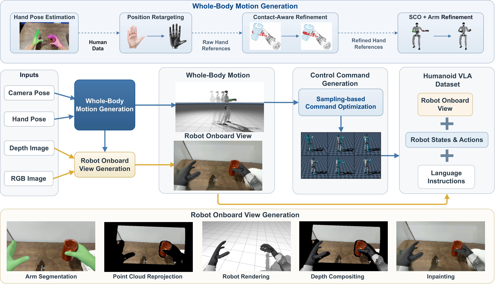

# KODA

**Kinematics–Observation Data Alignment for Humanoid Learning from Human Egocentric Demonstration**

KODA is a data conversion framework for turning human egocentric demonstrations into reusable, controller-specific whole-body training data for humanoid loco-manipulation.

The project aligns human observations, head and hand motion cues, robot states, compatible actions, and task instructions on a shared control clock. Its conversion pipeline produces simulation-feasible whole-body motion, motion-aligned robot onboard views, and controller-specific state–action records that can be combined with real-robot demonstrations to train vision–language–action (VLA) policies.

---

## Overview

KODA converts a human egocentric demonstration into controller-specific whole-body training data in four steps:

| Step | Name | What happens |
| :---: | :--- | :--- |
| **01** | **Capture** — *Observe the task* | Record the human viewpoint, hand and head cues, and language goal with the demonstration. |
| **02** | **Convert** — *Recover whole-body motion* | Map visual motion into robot motion and robot views while preserving the original task context. |
| **03** | **Align** — *Instantiate the interface* | Project states and actions onto the target controller's compatible action space and control clock. |
| **04** | **Train** — *Fine-tune the policy* | Combine KODA records with robot demonstrations to train a controller-specific whole-body VLA. |

> Every training record keeps robot observations, whole-body states, compatible actions, and task instruction together, so later debugging can follow the same path as training.

---

## Pipeline



*Overview of the KODA conversion pipeline. The figure shows the human RGB-D inputs, whole-body motion generation, robot onboard-view synthesis, and controller-aligned VLA records.*

### 1. Whole-Body Motion Generation

Human hand observations are turned into refined, contact-aware robot whole-body references:

1. **Hand Pose Estimation** – estimate hand poses from the egocentric view.
2. **Position Retargeting** – map human hand data into raw robot hand references.
3. **Contact-Aware Refinement** – refine the raw references into physically consistent hand motions.
4. **SCO + Arm Refinement** – resolve whole-body motion together with the arm trajectory.

### 2. Robot Onboard View Generation

Given the human RGB / depth images, camera pose, and the generated robot motion, KODA renders the motion-aligned robot onboard view:

- **Arm Segmentation** – segment the human arms from the egocentric frames.
- **Point Cloud Reprojection** – reproject the scene into the robot camera frame.
- **Robot Rendering** – render the simulated robot into the scene.
- **Depth Compositing** – compose the rendered robot with the observed scene by depth.
- **Inpainting** – inpaint the occluded regions to obtain the final onboard view.

### 3. Control Command Generation

Whole-body motion is converted into executable commands via **sampling-based command optimization**, producing the controller-specific actions aligned to the shared control clock.

### 4. Humanoid VLA Dataset

The output dataset combines, on a shared control clock:

- 📷 **Robot Onboard View** — motion-aligned, simulation-rendered onboard images.
- 🤖 **Robot States & Actions** — controller-compatible state–action records.
- 💬 **Language Instructions** — the task goal recorded with the demonstration.

---

## Open-Source Timeline

The implementation from the internal KODA pipeline has been staged in this repository. The table below records what is available here and what remains outside this release:

| Phase | Milestone | Deliverables | Status |
| :---: | :--- | :--- | :---: |
| 🚀 **M0** | **Project launch** | Project page, paper, and this repository | ✅ Done |
| 🧩 **M1** | **Core conversion pipeline** | RGB-D/MCAP conversion, hand pose estimation, hand retargeting, contact-aware refinement, SCO tracking, and arm refinement | ✅ Done |
| 🎥 **M2** | **Onboard view generation** | Arm segmentation, point-cloud reprojection, robot rendering, depth compositing, and inpainting | ✅ Done |
| 🎛️ **M3** | **Command generation & alignment** | SONIC motion-token export and GR00T-compatible state/action records; the complete HEFT command-generation path is not included yet | 🚧 Partial |
| 🗃️ **M4** | **Data release** | Reproducible data-processing tools and one public example MCAP through `TeleEmbodied/koda-assets` | 🚧 Partial |
| 🤖 **M5** | **Training & model details** | Controller-specific whole-body VLA training configs and model details | 🔜 Planned |

> **Status legend:** ✅ Done · 🚧 Partial or in progress · 🔜 Planned

This release includes the hand-processing code, including MANO/HaWoR hand estimation, BrainCo and Dex3 retargeting, contact-aware hand refinement, and hand–object geometric contact handling. The default runnable path is G1 + Dex3 + SONIC and ends at a GR00T-compatible dataset export. HEFT-specific controller replay/export and the training configurations used for the paper remain future work.

---

## Requirements

- Linux, NVIDIA GPU, and a CUDA-compatible driver
- Python 3.10–3.12
- [uv](https://docs.astral.sh/uv/)
- Storage for the model files; DiffuEraser's Stable Diffusion base alone is several GB
- IsaacLab/IsaacSim only for the optional GR00T fine-tuning stage

## Install

```bash
git clone https://github.com/Gamma-Robot/KODA.git
cd KODA
uv sync --extra cuda
```

All paths are relative to this checkout. `KODA_HOME`, `KODA_ASSETS`, and `KODA_CACHE` are optional overrides for a user's own directories.

## Download the example and public checkpoints

The only KODA-owned input is the example MCAP in the [`TeleEmbodied/koda-assets`](https://huggingface.co/datasets/TeleEmbodied/koda-assets) dataset. For a zero-token setup, set that Hugging Face dataset to **Public**. A private dataset requires a user access token with read permission:

```bash
uv run koda assets download --profile smoke
uv run koda assets verify --profile smoke
```

For the complete data pipeline, start the automatic downloads:

```bash
uv run koda assets download --profile full
```

This command downloads the public Hugging Face assets listed in [`assets/manifest.yaml`](assets/manifest.yaml). It prints the remaining manual steps instead of silently using a system or cluster path. Complete those steps and verify every file:

```bash
uv run koda assets verify --profile full
```

The manual assets are:

1. Register at [MANO](https://mano.is.tue.mpg.de/), accept its license, and copy `MANO_RIGHT.pkl` to `assets/models/mano/MANO_RIGHT.pkl`.
2. Clone [HaWoR](https://github.com/ThunderVVV/HaWoR) into `assets/models/hawor`. Download its `hawor.ckpt`, `infiller.pt`, `model_config.yaml`, and the WiLoR `detector.pt` listed in the manifest. The checkout must contain `lib/models/hawor.py`, `weights/hawor/...`, and `weights/external/detector.pt`.
3. Download the three [ProPainter v0.1.0 release](https://github.com/sczhou/ProPainter/releases/tag/v0.1.0) files (`ProPainter.pth`, `raft-things.pth`, and `recurrent_flow_completion.pth`) into `assets/models/diffueraser/propainter`.

All other model sources, revisions, destination paths, and required markers are recorded in the manifest. You may set `KODA_HAWOR_DIR` or `KODA_SCALEBFM_CHECKPOINT` to another user-owned checkout or checkpoint; no default points outside the repository.

## Run the complete data pipeline

```bash
uv run koda run \
  --input assets/samples/session_20260926_005030_iphone14_3 \
  --output outputs/example \
  --config configs/default.yaml \
  --gpu 0
```

Use `--frames 30` for a short smoke prefix. A successful run produces:

- `converted/`: MCAP-derived RGB-D and hand observations
- `tracking/`: 29-DoF G1 body plus 14-DoF Dex3 kinematics
- `view_change/`: fixed-camera RGB-D, robot render, and inpainted video
- `groot/`: SONIC tokens and the GR00T-compatible LeRobot dataset
- `run_manifest.json`: every stage command, log path, and return code
- `pipeline_result.json`: final output locations

The data pipeline ends at the GR00T dataset export. `koda finetune` is an optional adapter that runs a user-supplied IsaacLab/IsaacSim command:

```bash
KODA_FINETUNE_COMMAND='...' uv run koda finetune \
  --input outputs/example/groot \
  --output outputs/example \
  --config configs/default.yaml \
  --gpu 0
```

The command receives `KODA_DATASET` and `KODA_OUTPUT`. IsaacLab/IsaacSim is intentionally not vendored because it is a separate runtime with its own installation and license.

## Checks

```bash
uv run koda validate --profile smoke
uv run python scripts/validate_pipeline_layout.py
```

Generated data, caches, model files, and releases are ignored by Git. See the [project page](https://koda-humanoid.github.io/koda/) for background and paper updates.

## Project Page

- 🌐 Website: <https://koda-humanoid.github.io/koda/>
- 💻 Code repository: <https://github.com/Gamma-Robot/KODA>

---

## Citation
```bibtex
@misc{zhou2026koda,
  title         = {KODA: Kinematics--Observation Data Alignment for Humanoid Learning from Human Egocentric Demonstration},
  author        = {Zibo Zhou and Yueru Chen and Junsong Wu and Weiji Xie and Qingyao Xu and Sheng Yin and Shiqing Wang and Jiyuan Shi and Siheng Chen and Chenjia Bai and Xuelong Li},
  year          = {2026},
  eprint        = {2610.21152},
  archivePrefix = {arXiv},
  primaryClass  = {cs.RO},
  url           = {https://arxiv.org/abs/2610.21152v1}
}
```

---

## License

KODA integration code and each vendored upstream component retain their own license. MANO, robot meshes, and model checkpoints may have additional terms; read [`docs/THIRD_PARTY.md`](docs/THIRD_PARTY.md) before redistribution.
